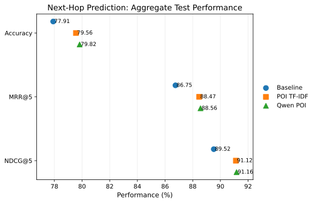
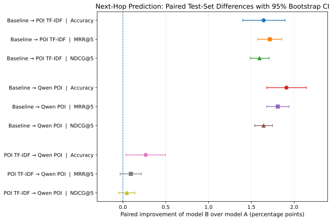
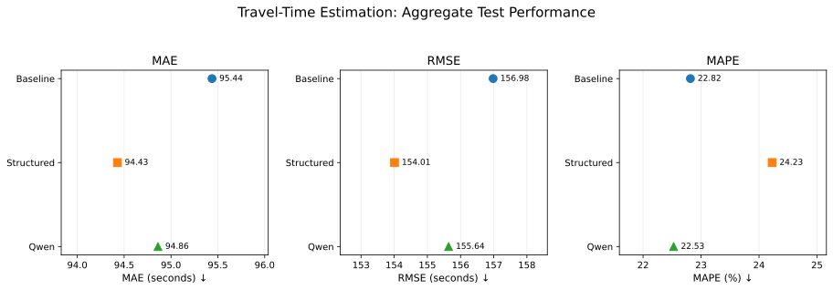
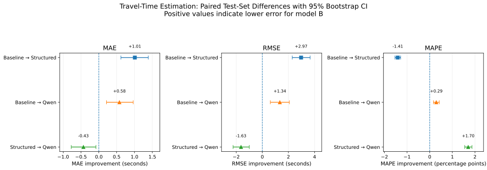

# Deep Learning for Human Mobility Prediction

This project implements semantic enrichment for **Next-Hop Prediction (NH)** and
**Travel-Time Estimation (TTE)** in the master's thesis *Deep Learning for Human
Mobility Prediction*. It extends [BIGCity](https://github.com/bigscity/BIGCity)
with task-specific models, preprocessing, six experiment configurations, evaluation
and statistical analysis.

Start with [installation and BIGCity integration](docs/installation.md), then
follow the [reproduction guide](docs/reproduction.md) and
[command reference](docs/workflow.md).

## Research overview

The thesis studies whether road-context semantics improve mobility prediction
under a common experimental protocol. It contributes task-specific semantic
cache builders, controlled experiment specifications, strict artifact checks,
paired statistical analysis and reproducibility tooling for six final XA runs.

[BIGCity](https://github.com/bigscity/BIGCity) supplies the original spatiotemporal
representation and model foundation. See Yu et al.,
[BIGCity: A Universal Spatiotemporal Model for Unified Trajectory and Traffic State Data Analysis](https://arxiv.org/abs/2412.00953).
The source dependency is pinned to
[`5f7168bf7a43c3a40e19e4a80cdb6d77b080edec`](https://github.com/bigscity/BIGCity/tree/5f7168bf7a43c3a40e19e4a80cdb6d77b080edec).
The thesis extensions and results below should not be confused with the original
paper's full multi-task benchmark.

## Tasks and six canonical experiments

NH predicts the next road segment from a trajectory prefix. TTE predicts total
trip duration from the route and departure-time inputs; intermediate/arrival
trajectory timestamps are not supplied as model inputs.

| Experiment | Semantic mode | Representation |
| --- | --- | --- |
| NH Baseline | `none` | No semantic feature injection |
| NH POI TF-IDF | `poi_tfidf` | 204 POI TYPE counts per road, weighted by smoothed IDF |
| NH Qwen POI | `poi_qwen_tfidf` | 1,024-dimensional Qwen TYPE prototypes combined with the same road TF-IDF weights |
| TTE Baseline | `none` | No semantic feature injection |
| TTE Structured | `tte_structured` | 10 binary road-context facts per road |
| TTE Qwen | `tte_qwen` | 1,024-dimensional embeddings of those same 10 concepts, summed by active fact and normalized |

NH TF-IDF uses `count * (log((N + 1) / (df + 1)) + 1)`, with `N = 5,269` roads.
For NH Qwen, unique POI names are embedded; each TYPE prototype is the normalized
mean of its unique NAME embeddings. Raw road vectors are TF-IDF-weighted sums
stored in float64, then cast and L2-normalized by the model. POI names enrich the
TYPE representation; this is distinct from the fact-matched TTE comparison.

The TTE fact order is `tunnel`, `bridge`, `roundabout`, `oneway`, `fuel_station`,
`parking`, `transport_hub`, `taxi_stand`, `transit_stop`, `logistics_freight`.
The structured cache is a **5,269 x 10 float32 binary tensor**. TTE Qwen introduces
no additional road facts: it embeds fixed descriptions of these concepts and
preserves exact zeros for roads with no active facts. For every semantic mode,
the model normalizes nonzero rows and uses a bias-free, zero-initialized projection
to the 768-dimensional backbone representation. The task and semantic extensions
are implemented in `models/bigcity4tte.py` and `models/thesis_semantics.py`.
Required upstream modules are adapted locally during integration.

All six configurations retain seed **2021**, batch size **32**, learning rate
**0.0002**, weight decay **0**, maximum **20 epochs**, patience **3**, controlled
dynamic mode and `static_ablation=none`. NH checkpoints are selected by strictly
higher validation accuracy; TTE checkpoints by strictly lower validation MAE.
TTE uses training-split target normalization and SmoothL1 loss.

## Canonical results

Each task uses **76,923 test samples**. The tables below report the final thesis
results; exact values and provenance are retained with the aggregate outputs.

| NH experiment | Accuracy (%) | MRR@5 (%) | NDCG@5 (%) | Best epoch |
| --- | ---: | ---: | ---: | ---: |
| Baseline | 77.9143 | 86.7511 | 89.5217 | 10 |
| POI TF-IDF | 79.5575 | 88.4665 | 91.1168 | 6 |
| Qwen POI | 79.8240 | 88.5598 | 91.1645 | 8 |

| TTE experiment | MAE (s) | RMSE (s) | MAPE (%) | Best epoch |
| --- | ---: | ---: | ---: | ---: |
| Baseline | 95.4380 | 156.9819 | 22.8165 | 16 |
| Structured | 94.4284 | 154.0098 | 24.2273 | 11 |
| Qwen | 94.8611 | 155.6393 | 22.5269 | 13 |

Qwen POI has the highest NH accuracy. Structured TTE has the lowest MAE/RMSE,
while Qwen TTE has the lowest MAPE. Structured TTE therefore improves absolute
error while worsening relative percentage error. These findings concern one
training seed and the selected checkpoints, not variability across training runs.

Exact values and provenance are in [canonical_metrics.json](results/canonical_metrics.json).
Small differences between TTE runner metrics and CSV-reconstructed metrics are
floating-point effects below the displayed precision. The aggregate CSVs retain
their original bytes. NH paired analysis uses McNemar tests; TTE uses exact sign
tests; both include Holm adjustment and 2,000-repetition paired bootstrap intervals.
Those intervals describe test-sample uncertainty conditional on fixed checkpoints.






## Project structure

```text
setup/                         integration CLI and transparent AST edits
config/thesis_paths.py         canonical source/cache bindings
models/                        thesis semantics/checkpoint/TTE task and attention hook
train_next_hop.py, train_tte.py canonical task runners
data_provider/                 controlled preprocessing and task dataset modules
experiments/                   six unchanged experiment specifications
scripts/                       cache builders, exporters, statistics, figures and checks
tests/                         integration safety and selected synthetic regressions
reproducibility/               input/output fingerprints, provenance and inventories
environments/                  separate BIGCity, Qwen and analysis snapshots
results/, assets/figures/       selected archived aggregate results and final figures
docs/                          installation, reproduction and upstream changes
```

The [source inventory](docs/file_selection.md) describes each component.
[Upstream adaptations](docs/UPSTREAM_CHANGES.md) documents the eight changes applied
to external BIGCity source. Data, weights and generated caches are acquired or
created separately.

## Install and integrate

Use **Python 3.12** and Git. The source integration CLI uses the standard library.
The verified interpreter was 3.12.10 on Windows. Scientific environments are
separate: BIGCity uses Transformers 4.47.1; Qwen uses 4.51.3. Do not merge them.
The environment snapshots are observed versions, not a clean-install guarantee.

After cloning this repository, acquire BIGCity into a separate directory:

```sh
git -c core.autocrlf=false clone --filter=blob:none --no-checkout https://github.com/bigscity/BIGCity.git "$BIGCITY_ROOT"
git -C "$BIGCITY_ROOT" -c core.autocrlf=false checkout --detach 5f7168bf7a43c3a40e19e4a80cdb6d77b080edec
python -B setup/integrate_bigcity.py --bigcity-root "$BIGCITY_ROOT" --output "$ADAPTED_ROOT" --dry-run
python -B setup/integrate_bigcity.py --bigcity-root "$BIGCITY_ROOT" --output "$ADAPTED_ROOT"
python -B setup/integrate_bigcity.py --bigcity-root "$BIGCITY_ROOT" --output "$ADAPTED_ROOT" --verify-only
```

Shell examples use POSIX variables/continuations; adapt them for PowerShell. Choose
an existing parent and a new output separate from both source directories. The
source checkout is never changed. The output has `runtime/`, eight original source
backups and a deterministic integration manifest. Repeating integration verifies
all files and writes nothing. Wrong revision/preimage, missing files and damaged
outputs fail rather than being repaired or overwritten. No in-place mode exists.

[Installation instructions](docs/installation.md) explain separate environments,
strict LF source hashes, output safeguards and the actual verification commands.
The integrator applies all eight changes for the canonical
controlled/static-none profile.

## External data and pretrained assets

Acquire XA sources from the [BIGCity dataset provider](https://huggingface.co/datasets/XieYuBUAA/BIGCity_Dataset)
and pretrained weights from the [provider linked by BIGCity](https://huggingface.co/XieYuBUAA/BIGCity/tree/main).
Review the providers' terms. DATASET_ROOT is the parent of `xa/`. Raw input and
cache identities are recorded in [external_artifacts.json](reproducibility/external_artifacts.json).
The official pretrained SHA256 remains
`612A663D81A3EB3173173D242023D7C4B86B650D103DE9EFB868FCFE0C2DBDA4`.
GPT-2 and Qwen assets are obtained separately and supplied through explicit paths.
NH Qwen revision is `97b0c614be4d77ee51c0cef4e5f07c00f9eb65b3`; historical TTE
Qwen revision and original XA archive/split-generation provenance remain incomplete.

The six fine-tuned thesis checkpoints are not uploaded. Historical verification
keeps their strict hashes. Fresh reproduction evaluates validation-selected new
checkpoints with their own hashes, not historical fine-tuned byte identities.

## Preprocess, train and evaluate

Run preprocessing from `ADAPTED_ROOT/runtime`. Shared controlled dynamic,
structural and full-metadata construction precedes task split caches. Semantic
builders are separate branches for the selected mode. Full metadata computes its
five counts from real loader functions, never from an existing metadata JSON.

The structured TTE builder reconstructs the 5,269 x 10 binary float32 tensor from
three source files and refuses existing outputs:

```sh
python -B -m scripts.build_tte_structured_semantic_cache \
  --road-file "$DATASET_ROOT/xa/road_xa.csv" --poi-file "$DATASET_ROOT/xa/POI_xa.csv" \
  --mapping-file "$DATASET_ROOT/xa/road2poi_xa.json" \
  --output "$CACHE_ROOT/structured.pth" --metadata-output "$CACHE_ROOT/structured.meta.json"
```

Canonical tensor SHA256 is
`52EAE4C2E30FF4A91858645A37AFE59BC0E1882D1DBA8543FAE1E0E95EF7F189`.
Tensor equality is distinct from whole `.pth` serialization equality. Structural
and NH split-cache wrappers still require the documented `../dataset` layout.
No unsupported dataset-root flag is implied for those two builders.

From the thesis clone, resolve (print) an experiment argv without starting training:

```sh
python -B -m scripts.portable_runtime_support \
  --experiment experiments/nh_baseline.json --runtime-root "$ADAPTED_ROOT/runtime" \
  --dataset-root "$DATASET_ROOT" --pretrained-checkpoint "$PRETRAINED" \
  --gpt2-path "$GPT2_DIR" --run-root "$RUN_ROOT"
```

Repeat for all six JSONs and separately execute the printed runner argv from the
integrated runtime when intended. [Reproduction instructions](docs/reproduction.md)
and [exact preprocessing/export/analysis recipes](docs/workflow.md) cover TF-IDF,
Qwen prototypes/roads, TTE Qwen, split caches, historical/fresh checkpoint manifests,
selected-checkpoint export, paired statistics and figure generation.

## Verification and limitations

```sh
python -B -m scripts.verify_public_candidate --runtime-root "$ADAPTED_ROOT/runtime"
python -B -m scripts.run_selected_tests --group tooling --staging-root "$NEW_TOOLING_TEST_ROOT"
python -B -m scripts.run_selected_tests --group science --staging-root "$NEW_SCIENCE_TEST_ROOT"
python -B -m scripts.run_selected_tests --group runtime --runtime-root "$ADAPTED_ROOT/runtime" --staging-root "$NEW_RUNTIME_TEST_ROOT"
```

Source integration, deterministic outputs, configuration compatibility and
selected CPU synthetic tests have been verified. The TTE attention adapter matches
canonical tokens and helper gradients on five synthetic fixtures. See
[Testing and Verification](docs/verification.md) for coverage and commands.

Clean installation, other platforms, real-weight/GPU numerical equivalence,
fresh training convergence, Qwen cache generation and full-test re-evaluation
have not been tested for this implementation. XA archive/split provenance and
the historical TTE Qwen revision remain incomplete. The structural and NH cache
builders require the documented `../dataset` layout.

The results use one training seed. Paired test-sample intervals do not measure
variation across training seeds. Historical checkpoint verification remains
separate from evaluating newly trained checkpoints.

## Citation and licensing

[CITATION.md](CITATION.md) identifies the thesis project and BIGCity reference;
the full institutional thesis citation is not yet confirmed. No license has been
selected for the thesis-authored code. See [LICENSE_STATUS.md](LICENSE_STATUS.md)
and [THIRD_PARTY_NOTICES.md](THIRD_PARTY_NOTICES.md) for the current terms and
restrictions, including locally generated BIGCity source and backups.
